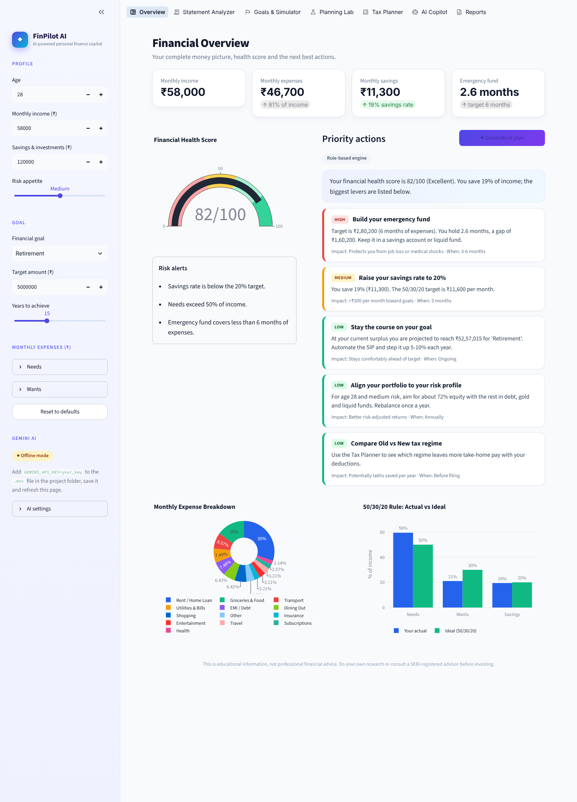

# ◆ FinPilot AI - Personal Finance Copilot

A modern, multi-page AI finance platform built with **Streamlit** and **Google Gemini**. It analyses bank statements,
forecasts spending, plans goals with Monte Carlo simulation, compares tax regimes, optimises debt payoff, plans
financial independence (FIRE), checks big-purchase affordability and chats with a streaming AI copilot that knows
your real numbers.

> Educational project - not professional financial advice.



## Highlights
| Page | What it does |
|---|---|
| **Overview** | KPIs, 0-100 health score, risk alerts, prioritised action plan (Gemini JSON or rules), spending charts |
| **Statement Analyzer** | CSV/Excel upload, auto-categorisation (keywords + Gemini for unknowns), recurring payments, anomaly detection, 3-month forecast, AI insights |
| **Goals & Simulator** | Required SIP, what-if slider, asset allocation, **Monte Carlo** (2,000 market paths, goal probability) |
| **Planning Lab** | **Debt payoff** (avalanche vs snowball vs minimum), **FIRE planner**, **Purchase analyzer** with AI second opinion |
| **Tax Planner** | Old vs New regime (FY 2026-27), 87A rebate and marginal relief, break-even deductions |
| **AI Copilot** | Streaming Gemini chat grounded in your profile and statement; "what the copilot can see" transparency panel |
| **Reports** | Markdown, print-ready HTML (save as PDF) and CSV downloads |

Everything also works **offline** (rule-based engine) when no API key is configured, and automatically falls back if
Gemini is unavailable.

## Quick start
```bash
pip install -r requirements.txt
python -m streamlit run app.py        # opens http://localhost:8501
```
Windows: double-click **`run_app.bat`** (Mac/Linux: `./run_app.sh`). Install packages only the first time.

## Gemini API key (.env)
1. Create a free key at https://aistudio.google.com/apikey
2. In the project folder (next to `app.py`) create a file named **`.env`** - or copy `.env.example` to `.env`:
   ```
   GEMINI_API_KEY=your_real_key
   ```
3. Save and refresh the page. The sidebar shows **● Connected** with a masked key.

Also accepted: `GOOGLE_API_KEY`. The `.env` file is git-ignored, the key is never logged or displayed in full, and it
is read on the server only. Use **AI settings** in the sidebar to switch model or test the connection.
Models: `gemini-3.5-flash` (default) with automatic fallback to `gemini-2.5-flash` / `gemini-2.5-pro`.

## Demo flow
1. **Statement Analyzer** > *Load sample data* > see forecast, subscriptions and the unusual ₹18,000 laptop purchase.
2. *Apply these averages to my profile* > sidebar updates everywhere.
3. **Goals & Simulator** > drag the Monte Carlo sliders.
4. **Planning Lab** > edit the debt table, try FIRE and the purchase analyzer.
5. **AI Copilot** > click a suggested question and watch the streamed answer.

## Architecture
```
app.py                  entrypoint: config, CSS, sidebar profile, top navigation
views/                  7 pages (overview, statement, goals, lab, tax, copilot, reports)
src/config.py           .env loading, key discovery, masking, model list
src/llm.py              Gemini wrapper: streaming, model fallback, JSON mode, friendly errors
src/advisor.py          prompts, structured action plan, offline engine, streaming advisor
src/budget.py           50/30/20 analysis and health score
src/transactions.py     statement parsing, categorisation, recurring, anomalies
src/forecast.py         expense forecast        src/simulation.py   Monte Carlo
src/projections.py      SIP maths, allocation   src/tax.py          Old vs New regime
src/debt.py             EMI + payoff strategies src/fire.py         FIRE planner
src/affordability.py    purchase analysis       src/report.py       Markdown/HTML reports
src/state.py, ui.py     shared state, sticky widgets, design system
tests/                  82 pytest tests (incl. mocked Gemini client)
scripts/smoke_test.py   browser test that visits every page
data/sample_statement.csv   6 months of demo transactions
```

## Testing
```bash
pytest -q                               # 82 unit tests, no network or key needed
python scripts/smoke_test.py            # opens every page in headless Chromium (pip install playwright)
```

## Statement format
Columns are auto-detected: `Date`, `Description / Narration / Particulars`, and `Debit` + `Credit` (or Withdrawal +
Deposit) or a single `Amount` with a Dr/Cr type column.

## Assumptions and limits
- Returns (7/10/12%), volatility (6/12/18%) and inflation (6%) are illustrative, not guarantees.
- Tax: salaried, age below 60, surcharge excluded; slabs per published FY 2026-27 tables - verify before filing.
- Currency and instruments (SIP, PPF, NPS, 80C) are India-specific.
- Statement data stays in your browser session. Only a compact summary is sent to Gemini, and only when you use an AI feature.
